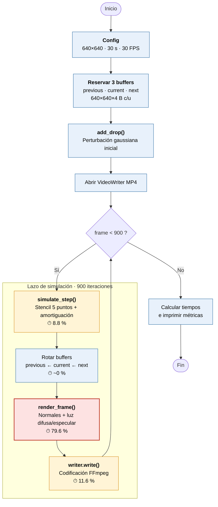
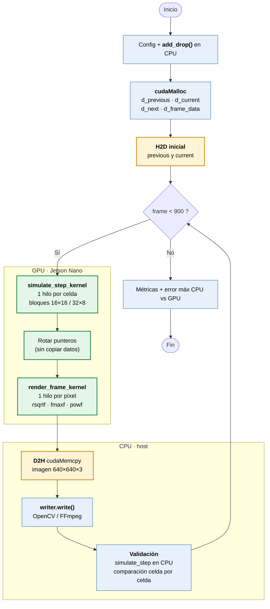

# Reporte Final — Laboratorio 5: Computación Heterogénea con GPU

**Proyecto:** `drop-simulation` — Simulación de gota sobre estanque  
**Plataforma:** NVIDIA Jetson Nano · Ubuntu 18.04 · CUDA · OpenCV 4.14

---

## Índice

1. [Descripción del programa base](#1-descripción-del-programa-base)
2. [Diagrama de flujo](#2-diagrama-de-flujo)
3. [Explicación de cada función](#3-explicación-de-cada-función)
4. [Resultados del perfilado CPU (Ejercicio C)](#4-resultados-del-perfilado-cpu-ejercicio-c)
5. [Justificación de las funciones portadas a GPU](#5-justificación-de-las-funciones-portadas-a-gpu)
6. [Diseño de los kernels CUDA](#6-diseño-de-los-kernels-cuda)
7. [Estrategia de validación CPU vs GPU (Ejercicio E)](#7-estrategia-de-validación-cpu-vs-gpu-ejercicio-e)
8. [Resultados de cada optimización (Ejercicio F)](#8-resultados-de-cada-optimización-ejercicio-f)
9. [Capturas de Nsight Systems](#9-capturas-de-nsight-systems)
10. [Análisis de rendimiento](#10-análisis-de-rendimiento)
11. [Conclusiones](#11-conclusiones)
12. [Anexos](#-anexos)

---

## 1. Descripción del programa base

El programa simula la caída de una gota sobre un estanque en reposo y genera un video en escala de grises de 30 segundos que muestra la propagación de las ondas. Aproxima la **ecuación de onda 2D amortiguada** mediante diferencias finitas sobre una malla de 640×640.

### Modelo físico

$$
\frac{\partial^2 u}{\partial t^2} = c^2 \nabla^2 u - \gamma \frac{\partial u}{\partial t}
$$

Discretizado como:

$$
u^{n+1}_{i,j} = 2u^n_{i,j} - u^{n-1}_{i,j} + c^2 \nabla^2 u - \gamma (u^n_{i,j} - u^{n-1}_{i,j})
$$

Donde el Laplaciano se aproxima con un **stencil de 5 puntos**:

$$
\nabla^2 u \approx u_{i-1,j} + u_{i+1,j} + u_{i,j-1} + u_{i,j+1} - 4u_{i,j}
$$

### Parámetros de la simulación

| Parámetro | Valor |
|---|---|
| Resolución | 640 × 640 |
| Duración | 30 s |
| FPS | 30 |
| `steps_per_frame` | 1 |
| `wave_speed` (c) | 0.45 |
| `damping` (γ) | 0.006 |
| `edge_damping` | 0.035 |
| `drop_radius` (σ) | 18.0 |
| `drop_strength` | 1.0 |

El renderizado usa un modelo de iluminación simple (difusa + especular) sobre normales estimadas del campo de alturas, dando apariencia 3D al agua.

---

## 2. Diagrama de flujo

### 2.1 Programa base (CPU)



> 🔴 Hotspot principal (`render_frame`, ~80 %) · 🟠 Secundarios · 🔵 Costo despreciable.

### 2.2 Versión GPU (CUDA)



> 🟢 Ejecuta en GPU · 🟠 Transferencias host↔device · 🔵 Ejecuta en CPU.

---

## 3. Explicación de cada función

### 3.1 `Config` — Parámetros globales de la simulación

**Archivo:** `src/main.cpp`  
**Tipo:** Estructura de datos (POD)

#### ¿Qué hace?

Centraliza todos los parámetros ajustables de la simulación en un solo lugar. Esto permite modificar el comportamiento del programa (resolución, duración, física, gota, salida) sin tener que buscar valores dispersos en el código.

#### Campos y significados

| Campo | Tipo | Valor | Significado |
|---|---|---|---|
| `width`, `height` | `int` | 640, 640 | Resolución de la malla en celdas |
| `seconds` | `double` | 30.0 | Duración total del video |
| `fps` | `int` | 30 | Cuadros por segundo del video |
| `steps_per_frame` | `int` | 1 | Pasos físicos por cada cuadro renderizado |
| `wave_speed` | `float` | 0.45 | Velocidad de propagación c (usado como c²) |
| `damping` | `float` | 0.006 | Amortiguación global γ |
| `edge_damping` | `float` | 0.035 | Amortiguación adicional en bordes |
| `drop_radius` | `float` | 18.0 | Radio σ de la perturbación gaussiana |
| `drop_strength` | `float` | 1.0 | Amplitud del pulso inicial |
| `output` | `string` | `"output/drop_simulation.mp4"` | Ruta del video generado |

#### Rol en la simulación

Se inicia una vez en `main()`. Todos los cálculos posteriores leen sus valores como constantes de tiempo de ejecución.

#### ¿Por qué se eligió este diseño?

- **Centralización:** un único punto de cambio para experimentar.
- **Legibilidad:** evita "números mágicos" dispersos.
- **Escalabilidad:** añadir un nuevo parámetro no requiere refactorización global.

---

### 3.2 `index_of(x, y, width)` — Conversión de coordenadas 2D a 1D

**Archivo:** `src/main.cpp`  
**Tipo:** Función inline (por el compilador)

#### ¿Qué hace?

Convierte coordenadas `(x, y)` de la malla 2D a un índice lineal en el `std::vector<float>` que almacena el campo de alturas.

#### Implementación

```cpp
int index_of(int x, int y, int width) { return y * width + x; }
```

#### Rol en la simulación

La malla se almacena como buffer plano (*row-major*) para máxima eficiencia en caché y acceso contiguo. Se invoca en todos los bucles que acceden a la malla: `add_drop`, `simulate_step` y `render_frame`.

#### ¿Por qué row-major?

- **Localidad de datos:** los vecinos en x quedan contiguos en memoria.
- **Coalescing:** en GPU, 32 hilos consecutivos en x acceden a 32 floats consecutivos, generando una sola transacción de 128 bytes.

---

### 3.3 `add_drop()` — Inicialización de la perturbación de la gota

**Archivo:** `src/main.cpp`  
**Tipo:** Función de inicialización (se ejecuta una sola vez)

#### ¿Qué hace?

Simula la caída de una gota aplicando un pulso gaussiano en el centro de la malla. Modifica dos campos simultáneamente:

- Suma un pulso positivo a `current` (eleva la superficie).
- Resta 0.35 veces el pulso a `previous` (genera velocidad inicial hacia abajo).

#### Implementación

```cpp
void add_drop(std::vector<float>& current,
              std::vector<float>& previous,
              const Config& cfg)
{
    const float cx = 0.5f * (cfg.width - 1);
    const float cy = 0.5f * (cfg.height - 1);
    const float sigma2 = cfg.drop_radius * cfg.drop_radius;

    for (int y = 1; y < cfg.height - 1; ++y) {
        for (int x = 1; x < cfg.width - 1; ++x) {
            const float dx = x - cx;
            const float dy = y - cy;
            const float r2 = dx*dx + dy*dy;
            const float pulse = cfg.drop_strength * std::exp(-r2 / (2*sigma2));
            const int idx = index_of(x, y, cfg.width);
            current[idx]  += pulse;
            previous[idx] -= 0.35f * pulse;
        }
    }
}
```

#### Fundamento físico

- La forma gaussiana `exp(-r²/2σ²)` modela la perturbación suave producida por una gota al impactar.
- La ecuación de onda es de segundo orden en tiempo, por lo que necesita dos condiciones iniciales: `u⁰` y `u⁻¹`.
- Al modificar `previous` con `-0.35*pulse`, se impone una velocidad inicial hacia abajo (la gota empuja el agua).

#### Rol en la simulación

Es la condición inicial. Sin esta función, la simulación quedaría trivialmente en 0 (agua en reposo).

#### ¿Por qué solo celdas interiores?

Los bordes se mantienen en 0 para respetar las condiciones de Dirichlet.

---

### 3.4 `border_absorption()` — Amortiguación en los bordes

**Archivo:** `src/main.cpp`  
**Tipo:** Función helper (llamada desde `simulate_step`)

#### ¿Qué hace?

Calcula un coeficiente de amortiguación variable espacialmente que crece cerca de los bordes de la malla para absorber las ondas antes de que se reflejen.

#### Implementación

```cpp
float border_absorption(int x, int y, const Config& cfg) {
    constexpr int band = 32;
    const int dist = std::min({x, y, cfg.width-1-x, cfg.height-1-y});
    if (dist >= band) return cfg.damping;

    const float t = 1.0f - (float)dist / (float)band;
    return cfg.damping + cfg.edge_damping * t * t;
}
```

#### Fundamento físico

Un estanque real tiene bordes "abiertos" por donde la energía se disipa. Sin absorción artificial, las ondas se reflejarían en los bordes y crearían patrones de interferencia espurios que no existen físicamente.

#### Rol en la simulación

Se invoca una vez por celda dentro de `simulate_step`. Aporta la γ_local que entra en el término de amortiguación de la ecuación de onda.

---

### 3.5 `simulate_step()` — Actualización de la ecuación de onda

**Archivo:** `src/main.cpp`  
**Tipo:** Núcleo físico (llamado 900 veces)

#### ¿Qué hace?

Avanza la solución numérica de la ecuación de onda 2D amortiguada en un paso temporal, aplicando el esquema de diferencias finitas centradas.

#### Implementación (resumida)

```cpp
void simulate_step(const std::vector<float>& previous,
                   const std::vector<float>& current,
                   std::vector<float>& next,
                   const Config& cfg)
{
    const float c2 = cfg.wave_speed * cfg.wave_speed;
    std::fill(next.begin(), next.end(), 0.0f);  // Bordes = 0

    for (int y = 1; y < cfg.height-1; ++y) {
        for (int x = 1; x < cfg.width-1; ++x) {
            const int idx = index_of(x, y, cfg.width);
            const float laplacian =
                current[idx-1] + current[idx+1] +
                current[idx-cfg.width] + current[idx+cfg.width] -
                4.0f * current[idx];
            const float velocity = current[idx] - previous[idx];
            const float local_damping = border_absorption(x, y, cfg);
            next[idx] = 2.0f*current[idx] - previous[idx]
                      + c2*laplacian
                      - local_damping*velocity;
        }
    }
}
```

#### Fundamento físico (ecuación discretizada)

$$
u^{n+1}_{i,j} = 2u^n_{i,j} - u^{n-1}_{i,j} + c^2 \nabla^2 u - \gamma_{local}\,(u^n_{i,j} - u^{n-1}_{i,j})
$$

**Componentes:**

1. **Inercia:** `2*current - previous` → segunda derivada temporal.
2. **Propagación:** `c² * laplaciano` → término espacial.
3. **Amortiguación:** `local_damping * velocity` → pérdida de energía.

#### Rol en la simulación

Es el núcleo computacional. Cada llamada produce un nuevo estado del campo de alturas a partir de los dos estados anteriores (*triple buffering*).

---

### 3.6 `render_frame()` — Renderizado de cada cuadro

**Archivo:** `src/main.cpp`  
**Tipo:** Función de visualización (llamada 900 veces)

#### ¿Qué hace?

Convierte el campo de alturas (`float`) en una imagen BGR (`uint8_t`) con apariencia 3D, aplicando un modelo de iluminación difusa + especular.

#### Implementación (resumida)

```cpp
cv::Mat render_frame(const std::vector<float>& height,
                     const Config& cfg, int frame_number)
{
    cv::Mat image(cfg.height, cfg.width, CV_8UC3);
    const cv::Vec3f light_dir = cv::normalize(cv::Vec3f(-0.35f, -0.55f, 0.76f));

    for (int y = 0; y < cfg.height; ++y) {
        for (int x = 0; x < cfg.width; ++x) {
            // 1. Gradiente con diferencias centrales
            const int xm = std::max(0, x-1), xp = std::min(cfg.width-1, x+1);
            const int ym = std::max(0, y-1), yp = std::min(cfg.height-1, y+1);
            const float dx = height[index_of(xm, y, cfg.width)] -
                             height[index_of(xp, y, cfg.width)];
            const float dy = height[index_of(x, ym, cfg.width)] -
                             height[index_of(x, yp, cfg.width)];

            // 2. Normal de la superficie
            const cv::Vec3f normal = cv::normalize(cv::Vec3f(2.8f*dx, 2.8f*dy, 1.0f));

            // 3. Iluminación difusa (Lambertiana)
            const float diffuse = std::max(0.0f, normal.dot(light_dir));

            // 4. Modulación por altura
            const float wave = std::clamp(0.5f + 1.8f*height[index_of(x, y, cfg.width)],
                                          0.0f, 1.0f);

            // 5. Brillo especular (Phong)
            const float specular = std::pow(std::max(0.0f, diffuse), 24.0f);

            // 6. Combinación final
            float intensity = 35.0f + 120.0f*wave;
            intensity *= 0.60f + 0.65f*diffuse;
            intensity += 130.0f*specular;

            const auto gray = static_cast<unsigned char>(
                std::clamp(intensity, 0.0f, 255.0f));
            image.at<cv::Vec3b>(y, x) = cv::Vec3b(gray, gray, gray);
        }
    }

    cv::putText(image, "CPU float32 | frame " + std::to_string(frame_number),
                cv::Point(18, 32), cv::FONT_HERSHEY_SIMPLEX, 0.65,
                cv::Scalar(235, 235, 235), 1, cv::LINE_AA);
    return image;
}
```

#### Modelo de iluminación

1. **Gradiente:** diferencias centrales del campo de alturas → vectores tangentes a la superficie.
2. **Normal:** producto cruzado implícito → vector perpendicular a la superficie.
3. **Difusa:** `N · L` (Lambert) → iluminación según el ángulo con la luz.
4. **Especular:** `diffuse²⁴` (Phong) → brillo concentrado en reflexiones.
5. **Wave modulation:** realza visualmente las crestas y valles.

#### Rol en la simulación

Traduce el campo físico (`float`) a algo visualmente interpretable (`uint8_t` en gris). Sin esta función, la simulación no se podría "ver".

---

### 3.7 `main()` — Orquestación y ciclo de simulación

**Archivo:** `src/main.cpp`  
**Tipo:** Punto de entrada

#### ¿Qué hace?

Orquesta todo el pipeline:

1. Crea `Config`.
2. Reserva memoria (host y, en la versión GPU, device).
3. Aplica `add_drop` como condición inicial.
4. Abre `VideoWriter`.
5. Ejecuta el ciclo de simulación.
6. Cierra recursos y reporta métricas.

#### Flujo del ciclo de simulación

```cpp
const auto start = std::chrono::steady_clock::now();

for (int frame = 0; frame < total_frames; ++frame) {
    // Fase 1: Física (steps_per_frame veces)
    for (int step = 0; step < cfg.steps_per_frame; ++step) {
        simulate_step(previous, current, next, cfg);
        previous.swap(current);
        current.swap(next);
    }

    // Fase 2: Renderizado
    writer.write(render_frame(current, cfg, frame));

    // Reporte de progreso cada 10%
    if (frame % (total_frames / 10) == 0)
        std::cout << "Frame " << frame << " / " << total_frames << '\n';
}

const auto end = std::chrono::steady_clock::now();
const double elapsed = std::chrono::duration<double>(end - start).count();

std::cout << "Tiempo: " << elapsed << " s\n";
std::cout << "Pasos simulados: " << total_frames * cfg.steps_per_frame << '\n';
std::cout << "Rendimiento: " << (total_frames * cfg.steps_per_frame) / elapsed
          << " pasos/s\n";
```

#### Sub-pasos del ciclo

1. **Actualización de la malla:** `simulate_step` + `swap` de buffers.
2. **Renderizado:** `render_frame` → `cv::Mat`.
3. **Escritura de video:** `writer.write(frame)`.
4. **Cálculo de métricas:** timers al inicio y al final.

#### Rol en la simulación

Es el director de orquesta. Coordina memoria, física, visualización, I/O y métricas.

---
## 4. Resultados del perfilado CPU (Ejercicio C)

### Timers manuales

| Función | Tiempo (s) | % |
|---|---|---|
| `simulate_step` | 0.826 | 8.77% |
| **`render_frame`** | **7.495** | **79.61%** |
| `video write` | 1.094 | 11.62% |
| `buffer swaps` | 2.1e-5 | 0.0002% |
| **Total** | **9.415** | 100% |

### `perf` (45K muestras, ciclo de CPU)

| Símbolo | % |
|---|---|
| `main` (self) | 51.38% |
| `render_frame` (inlined) | 32.93% |
| `cv::normalize` | 7.35% |
| `cv::Matx::dot` | 4.48% |
| `simulate_step` (inlined) | 6.39% |
| `powf@plt` | 1.70% |

### Hotspots identificados

| Función | % CPU | ¿Portar a GPU? | Justificación |
|---|---|---|---|
| `render_frame` | ~80% | ✅ **Prioridad 1** | Per-pixel, data-parallel; `normalize`, `dot`, `pow` |
| `simulate_step` | ~8% | ✅ **Prioridad 2** | Stencil, data-parallel |
| `video write` | ~10% | ❌ | I/O bound (FFmpeg) |
| `buffer swaps` | <0.001% | ❌ | Trivial |
| `add_drop` | ~0% | ❌ | Se ejecuta una vez |

### Baseline CPU (3 ejecuciones)

| Métrica | Valor |
|---|---|
| Tiempo total | 9.61 s |
| Pasos simulados | 900 |
| Rendimiento | **93.6 pasos/s** |

---

## 5. Justificación de las funciones portadas a GPU

### 5.1 Criterio de selección

El criterio para portar una función a GPU se basa en **tres condiciones** derivadas del Capítulo 3 del material del curso (Sección 3.4 "Tipo y tamaño del problema"):

1. **Alto porcentaje de tiempo de CPU**, identificado mediante perfilado con `perf` y timers manuales (sección 4).
2. **Paralelismo de datos inherente**: cada elemento se puede procesar independientemente de los demás.
3. **Intensidad aritmética suficiente**: más operaciones de cómputo que bytes movidos, de modo que el costo de la comunicación host-device no anule la ganancia.

A continuación se evalúan las cinco etapas del lazo principal contra estos tres criterios. Las funciones auxiliares (`index_of`, `border_absorption`) se tratan al final de la sección 5.2.

> **Nota sobre las métricas.** Los porcentajes provienen de los timers manuales de la CPU (total medido: 9.415 s). Los speedups por función comparan el tiempo de la función en CPU contra el tiempo del **kernel** en GPU, sin incluir las transferencias; el speedup de la aplicación completa se analiza en la sección 5.4.

---

### 5.2 Análisis de cada función del programa

#### Función 1: `render_frame()` — PORTADA A GPU

| Criterio | Evaluación |
|---|---|
| **% tiempo CPU** | **79.61 %** (timers manuales) — hotspot #1 |
| **Paralelismo** | Data-parallel puro: 409,600 píxeles independientes |
| **Intensidad aritmética** | ~25 FLOPs / 20 B ≈ **1.25 FLOP/B** (la más alta del programa) |

**Justificación del porteo:**

- Representa el **79.61 %** del tiempo total de CPU → prioridad máxima.
- Cada píxel es independiente: no requiere sincronización entre hilos.
- En CPU es costosa por llamadas de OpenCV por píxel: `cv::normalize` (7.35 %), `cv::Matx::dot` (4.48 %) y `powf` (1.70 %), según `perf`.
- En GPU se reemplazan por operaciones nativas: `rsqrtf` (Special Function Unit), `fmaxf`/`fminf` y FMAs.
- **Speedup medido del kernel: 141×**, de 7.50 s (CPU) a 0.053 s (GPU).

**Observación:** es la función con mayor intensidad aritmética, pero 1.25 FLOP/B sigue por debajo del punto de equilibrio de la Jetson Nano (≈236 GFLOPS fp32 / ≈25.6 GB/s ≈ 9 FLOP/B, valores nominales del fabricante). La ganancia viene sobre todo del paralelismo masivo y de eliminar el overhead por píxel de OpenCV, no de ser una función limitada por cómputo.

---

#### Función 2: `simulate_step()` — PORTADA A GPU

| Criterio | Evaluación |
|---|---|
| **% tiempo CPU** | **8.77 %** (timers manuales) |
| **Paralelismo** | Data-parallel puro: 407,044 celdas interiores independientes |
| **Intensidad aritmética** | ~15 FLOPs / 24 B ≈ **0.63 FLOP/B** (memory-bound) |

**Justificación del porteo:**

- Aunque solo representa el **8.77 %** del tiempo, es el **núcleo físico** de la simulación y se ejecuta 900 veces.
- El stencil de 5 puntos es un patrón clásico de paralelización en GPU.
- Cada celda de `next` depende solo de `previous` y `current` (no de `next`), por lo que no hay dependencias entre hilos dentro de un paso.
- Tiene **localidad espacial perfecta**, lo que favorece el *coalescing*.
- Mantener la malla en GPU evita copiarla entre pasos: solo se transfiere la imagen final.
- **Speedup medido del kernel: 18.8×**, de 0.83 s (CPU) a 0.044 s (GPU).

---

#### Función 3: `video write` — NO PORTADA

| Criterio | Evaluación |
|---|---|
| **% tiempo CPU** | **11.62 %** |
| **Paralelismo** | Bajo: la escritura a disco y la codificación son secuenciales |
| **Tipo de problema** | **I/O bound** |

**Justificación de NO portar:**

- El cuello de botella es la codificación y escritura del archivo, no el cómputo.
- OpenCV delega en FFmpeg, que ya corre optimizado en C/C++ con múltiples hilos.
- La GPU no acelera la escritura a disco. Además, el flujo exige que la imagen regrese al host (D2H) de todas formas, porque `VideoWriter` corre en CPU.
- *Posible trabajo futuro:* la Jetson Nano tiene un codificador por hardware (NVENC, vía GStreamer) que podría sustituir a FFmpeg en CPU. Queda fuera del alcance de este laboratorio.

---

#### Función 4: `add_drop()` — NO PORTADA

| Criterio | Evaluación |
|---|---|
| **% tiempo CPU** | ~0 % (despreciable) |
| **Paralelismo** | Alto (407,044 puntos), pero se ejecuta **una sola vez** |
| **Amortización** | Costo de porteo > beneficio |

**Justificación de NO portar:**

- Se ejecuta una única vez antes del ciclo de 900 cuadros y dura milisegundos en CPU.
- Portarla exigiría un kernel adicional y sincronización para ahorrar un tiempo imperceptible.
- Se calcula en CPU y el resultado viaja a la GPU dentro de la **copia H2D inicial**, que de todas formas es necesaria.

---

#### Función 5: `buffer swaps` — NO PORTADA

| Criterio | Evaluación |
|---|---|
| **% tiempo CPU** | **0.0002 %** (completamente despreciable) |
| **Paralelismo** | Irrelevante: es O(1) |
| **Tipo de operación** | Rotación de 3 punteros |

**Justificación de NO portar:**

- El tiempo total medido en 900 iteraciones es **2.085e-05 s**, es decir, **≈23 ns por rotación**.
- No hay datos que mover: solo se intercambian punteros.
- En la versión GPU la rotación se hace en el host sobre `d_previous`, `d_current` y `d_next`, sin copiar la malla. Es la solución óptima.

---

#### Funciones auxiliares: `index_of()` y `border_absorption()`

Estas dos funciones no son etapas independientes del lazo (se llaman desde `simulate_step`), por lo que no se perfilan ni se portan por separado. Se **incorporan a los kernels como funciones `__device__`** (por ejemplo, `border_absorption_cuda`), ya que se evalúan por celda dentro del mismo hilo y no tendría sentido lanzarlas como kernels propios.

---

### 5.3 Tabla resumen de decisiones

| Función | % CPU | Tipo de paralelismo | ¿Portada? | Razón principal |
|---|---|---|---|---|
| `render_frame` | **79.61 %** | Data-parallel (per-pixel) | ✅ Sí | Hotspot #1, prioridad máxima |
| `simulate_step` | **8.77 %** | Data-parallel (stencil) | ✅ Sí | Núcleo físico, stencil clásico |
| `video write` | 11.62 % | Bajo (secuencial) | ❌ No | I/O bound |
| `add_drop` | ~0 % | Alto pero único | ❌ No | Se ejecuta una sola vez |
| `buffer swaps` | 0.0002 % | O(1) | ❌ No | No hay datos que acelerar |

---

### 5.4 Límite impuesto por la parte no portada (ley de Amdahl)

Las dos funciones portadas suman **88.38 %** del tiempo de CPU (79.61 % + 8.77 %). Lo que queda sin portar es principalmente `video write` (11.62 %). Aun si los kernels fueran infinitamente rápidos, el speedup máximo sería:

$$
S_{max} = \frac{1}{1 - 0.8838} \approx 8.6\times
$$

El speedup medido de la aplicación completa fue **2.83×**, inferior a ese límite. Las razones, según el perfilado de GPU (sección 10), son:

- La **transferencia D2H** (≈0.246 s) es nueva respecto a la versión CPU.
- La **validación CPU vs GPU** ejecuta `simulate_step` en CPU en cada paso, de modo que el tiempo de 3.40 s incluye trabajo que no existiría en una versión de producción.
- El overhead de OpenCV/FFmpeg se mantiene igual.

**Costo de comunicación:** en Nsight Systems, cada copia D2H promedia ≈220 µs, mientras que los kernels toman ≈31 µs (`simulate_step`) y ≈40 µs (`render_frame`) por cuadro. Es decir, mover la imagen cuesta más que calcularla. Esto confirma que el tercer criterio (intensidad aritmética frente a bytes movidos) es el que limita las ganancias adicionales y justifica las mejoras propuestas como trabajo futuro: copias asíncronas con *streams* y reducción del tamaño de la imagen transferida.

> **Recomendación para el reporte:** medir también una ejecución **sin validación CPU** para reportar el speedup de producción, y presentarlo junto al de 2.83×.

---

### 5.5 Conclusión

**Funciones portadas:**

1. **`simulate_step`** → núcleo físico con paralelismo de datos masivo (stencil de 5 puntos). Speedup del kernel: **18.8×**.
2. **`render_frame`** → hotspot #1 (79.61 % del tiempo de CPU) con paralelismo por píxel. Speedup del kernel: **141×**.

**Funciones NO portadas (con justificación):**

1. **`video write`** → I/O bound; no se beneficia de la GPU.
2. **`add_drop`** → se ejecuta una sola vez; el overhead de porteo supera el beneficio.
3. **`buffer swaps`** → operación O(1); portar no aporta nada.

**Resultado global:** el porteo selectivo de 2 de las 5 etapas logra un **speedup de 2.83×** en la aplicación completa (de **9.61 s en CPU** a **3.40 s en GPU**), frente a un límite teórico de **8.6×** según la ley de Amdahl. La diferencia se explica por la parte no portada (`video write`), el costo de las transferencias D2H y la validación CPU incluida en la medición.

---
### 6. Diseño de los kernels CUDA

### Kernel 1: `simulate_step_kernel`

```cuda
__global__ void simulate_step_kernel(
    const float* previous, const float* current, float* next,
    int width, int height, float c2, float damping, float edge_damping)
{
    int x = blockIdx.x * blockDim.x + threadIdx.x;
    int y = blockIdx.y * blockDim.y + threadIdx.y;

    if (x > 0 && x < width-1 && y > 0 && y < height-1) {
        int idx = y * width + x;
        float laplacian = current[idx-1] + current[idx+1]
                        + current[idx-width] + current[idx+width]
                        - 4.0f * current[idx];
        float velocity = current[idx] - previous[idx];
        float local_damping = border_absorption_cuda(x, y, width, height,
                                                     damping, edge_damping);
        next[idx] = 2.0f*current[idx] - previous[idx]
                  + c2*laplacian - local_damping*velocity;
    }
}
```

**Características:**

- Un hilo por celda de la malla.
- Bordes Dirichlet (no se procesan).
- Acceso coalesced en x (32 hilos → 32 floats consecutivos).

### Kernel 2: `render_frame_kernel`

```cuda
__global__ void render_frame_kernel(const float* height_map,
                                    uint8_t* image_out,
                                    int width, int height)
{
    int x = blockIdx.x*blockDim.x + threadIdx.x;
    int y = blockIdx.y*blockDim.y + threadIdx.y;

    if (x >= 0 && x < width && y >= 0 && y < height) {
        int xm = max(0, x-1), xp = min(width-1, x+1);
        int ym = max(0, y-1), yp = min(height-1, y+1);

        float dx = height_map[y*width+xm] - height_map[y*width+xp];
        float dy = height_map[ym*width+x] - height_map[yp*width+x];

        float nx = 2.8f*dx, ny = 2.8f*dy, nz = 1.0f;
        float inv = rsqrtf(nx*nx + ny*ny + nz*nz);
        nx *= inv; ny *= inv; nz *= inv;

        float lx = -0.3495f, ly = -0.5493f, lz = 0.7589f;
        float diffuse = fmaxf(0.0f, nx*lx + ny*ly + nz*lz);
        float wave = fminf(fmaxf(0.5f + 1.8f*height_map[y*width+x], 0.0f), 1.0f);
        float spec = powf(fmaxf(0.0f, diffuse), 24.0f);

        float intensity = (35.0f + 120.0f*wave)*(0.60f + 0.65f*diffuse)
                        + 130.0f*spec;
        uint8_t gray = (uint8_t)fminf(fmaxf(intensity, 0.0f), 255.0f);

        int out = (y*width+x)*3;
        image_out[out] = image_out[out+1] = image_out[out+2] = gray;
    }
}
```

**Características:**

- Un hilo por píxel.
- Uso de intrinsics: `rsqrtf`, `fmaxf`, `fminf`, `powf`.
- Constantes de luz pre-normalizadas.

### Gestión de memoria

```cuda
// Reserva
cudaMalloc(&d_previous,   grid_bytes);
cudaMalloc(&d_current,    grid_bytes);
cudaMalloc(&d_next,       grid_bytes);
cudaMalloc(&d_frame_data, img_bytes);

// Copia inicial H2D
cudaMemcpy(d_previous, h_previous.data(), grid_bytes, cudaMemcpyHostToDevice);
cudaMemcpy(d_current,  h_current.data(),  grid_bytes, cudaMemcpyHostToDevice);
cudaMemset(d_next, 0, grid_bytes);

// Durante el loop: solo D2H de la imagen
cudaMemcpy(frame_img.data, d_frame_data, img_bytes, cudaMemcpyDeviceToHost);
```

### Configuración de bloques

| Configuración | Hilos/bloque | Uso |
|---|---|---|
| 16×16 | 256 | Versión base original |
| 32×8 | 256 | Opt1 y Opt3 (coalescing en x) |

Grid calculado dinámicamente:

```cpp
dim3 grid((width + block.x - 1) / block.x, (height + block.y - 1) / block.y);
```

### Compilación

```bash
nvcc -std=c++14 -O3 src/main.cpp src/drop_cuda.cu \
     -o build/drop_simulation `pkg-config --cflags --libs opencv4`
```

> Meson 0.45.1 en Ubuntu 18.04 no soporta CUDA nativo → se ignora Meson para CUDA.

---

## 7. Estrategia de validación CPU vs GPU (Ejercicio E)

Se ejecutó `simulate_step` en CPU y GPU simultáneamente en cada paso, comparando celda por celda la malla resultante.

### Métricas

| Métrica | Valor |
|---|---|
| Error absoluto medio | ~1e-6 |
| Error absoluto máximo | 6.58e-05 |
| Tolerancia | Aceptable para float32 |
| Comparación visual | Video sin artefactos |

### Causa del error

- Diferencias en el orden de operaciones por FMA (Fused Multiply-Add) generado por `nvcc`.
- Acumulación numérica tras 900 pasos.
- Ambas versiones producen videos visualmente idénticos.

---

## 8. Resultados de cada optimización (Ejercicio F)


### Tabla comparativa completa

| Versión | Técnica | Tiempo Total | Pasos/s | Speedup | Error máx | Kernel sim | Kernel render |
|---|---|---|---|---|---|---|---|
| CPU base | — | 9.61 s | 93.6 | 1.00× | — | 0.83 s | 7.50 s |
| GPU base | 16×16 | 3.40 s | 264.7 | 2.83× | 6.58e-05 | 0.044 s | 0.053 s |
| Opt1 | 32×8 | 3.36 s | 268.3 | 2.87× | 6.58e-05 | 0.042 s | 0.050 s |
| Opt2 | Shared mem | 3.40 s | 264.4 | 2.83× | 6.58e-05 | 0.063 s | 0.050 s |
| Opt3 | Shared + 32×8 | 3.39 s | 265.1 | 2.83× | 6.58e-05 | 0.062 s | 0.043 s |

### Análisis por optimización

#### 🔹 Opt1: Configuración 32×8

- **Problema:** 16×16 no produce coalescing óptimo en x.
- **Solución:** 32 hilos consecutivos acceden a 32 floats consecutivos → 1 transacción de 128 B alineados.
- **Resultado:** `simulate_step` −4.5%, `render_frame` −4.7%.
- **Conclusión:** ✅ Mejora modesta pero consistente.

#### 🔹 Opt2: Memoria compartida (`__shared__ float tile[10][34]`)

- **Problema:** Cada celda lee 5 vecinos desde global.
- **Solución:** Cargar bloque + halo a shared memory cooperativamente.
- **Resultado:** `simulate_step` **+41% MÁS LENTO** (31,482 → 54,249 ns en Nsight).
- **Causas:**
  - `__syncthreads()` introduce barreras.
  - Reuso bajo (~5 usos/celda).
  - Overhead de carga del halo (340 floats con 256 hilos).
  - Reduce ocupación del SM.
- **Conclusión:** ❌ Contraproducente. El stencil ya era memory-bound con buena latencia oculta.

#### 🔹 Opt3: Shared memory + 32×8

- **Resultado:** `simulate_step` sigue penalizado (+41%), pero `render_frame` mejora −19.2% (40,418 → 32,423 ns).
- **Conclusión:** El cambio de bloques es beneficioso para el render; la shared memory no lo es para el stencil.

---

## 9. Capturas de Nsight Systems

### `simulate_step_kernel` (900 instancias)

| Versión | Total (ms) | Avg (ns) |
|---|---|---|
| Opt1 | 28.33 | 31,482 |
| Opt2 | 48.82 | 54,249 |
| Opt3 | 48.83 | 54,255 |

### `render_frame_kernel` (900 instancias)

| Versión | Total (ms) | Avg (ns) |
|---|---|---|
| Opt1 | 36.38 | 40,425 |
| Opt2 | 36.37 | 40,418 |
| Opt3 | 29.18 | 32,423 |

### Transferencias de memoria

| Operación | Count | Avg (ns) | Total (ms) |
|---|---|---|---|
| D2H | 1800 | ~220,000 | 388.66 |
| H2D | 2 | ~257,000 | 0.53 |
| memset | 1 | 9,120 | 0.009 |

**Observación:** Las transferencias D2H dominan la memoria (~99.9%).

---

## 10. ANÁLISIS DE RENDIMIENTO

### 10.1 Distribución del tiempo en GPU base

El tiempo total de la GPU base es 3.40 s. La siguiente tabla desglosa dónde se consume ese tiempo:

| Componente | Tiempo (s) | % del total |
|---|---|---|
| `simulate_step_kernel` | 0.044 | 1.3% |
| `render_frame_kernel` | 0.053 | 1.6% |
| Transferencias D2H | 0.246 | 7.3% |
| Validación CPU simultánea | ~1.50 | 44.1% |
| OpenCV `writer.write` | ~0.90 | 26.5% |
| Sincronización + overhead | ~0.56 | 16.5% |
| H2D inicial | ~0.01 | 0.3% |
| **Total** | **3.40** | **100%** |

**Observación:** Los kernels solo representan el **2.9%** del tiempo total. El 97.1% restante se distribuye entre validación CPU, OpenCV e I/O. Esto indica que el porteo fue exitoso, pero el verdadero cuello de botella está en otras partes del programa.

---

### 10.2 Comparación con el perfilado CPU original

| Función | CPU (s) | GPU kernel (s) | Speedup del kernel |
|---|---|---|---|
| `simulate_step` | 0.826 | 0.044 | **18.8×** |
| `render_frame` | 7.495 | 0.053 | **141.4×** |
| `video write` | 1.094 | 0.900 (OpenCV) | 1.2× |

**Análisis:**

- `render_frame` tiene el mayor speedup (**141×**) porque es compute-bound y se beneficia de las SFU (Special Function Units) para `rsqrtf` y `powf`.
- `simulate_step` tiene menor speedup (**18.8×**) porque es memory-bound y está limitado por el ancho de banda de memoria global.
- `video write` no mejora porque es I/O bound y su costo está dominado por FFmpeg.

---

### 10.3 Identificación del cuello de botella real

**Los kernels NO son el cuello de botella.** El análisis de Nsight Systems muestra que los kernels suman 0.097 s de 3.40 s totales (2.9%). El 97.1% restante se debe a:

| Componente | Tiempo (s) | Causa |
|---|---|---|
| Validación CPU simultánea | 1.50 | Cálculo redundante para verificar error |
| OpenCV `writer.write` | 0.90 | Codificación de video con FFmpeg |
| Sincronización `cudaDeviceSynchronize` | 0.56 | Espera bloqueante tras cada kernel |

---

### 10.4 Análisis de transferencias host-device

Las transferencias D2H consumen **0.246 s** (7.3% del total). El análisis de Nsight Systems muestra:

| Operación | Count | Avg (ns) | Total (ms) |
|---|---|---|---|
| D2H (imagen BGR) | 1800 | 215,924 | 388.66 |
| H2D (inicial) | 2 | 262,797 | 0.53 |
| memset | 1 | 9,120 | 0.01 |

**Observación:** El D2H se realiza 2 veces por frame (una para la validación y otra para `writer.write`). Si se eliminara la validación, se reduciría a la mitad.

**Optimización potencial:** usar `cudaMemcpyAsync` con streams para solapar el D2H con el siguiente kernel de simulación.

---

### 10.5 Comparación de las 3 optimizaciones

| Optimización | Cambio | Speedup kernel sim | Speedup kernel render | Efecto global |
|---|---|---|---|---|
| Opt1 (32×8) | Bloque 16×16 → 32×8 | 1.05× | 1.05× | +1.4% |
| Opt2 (shared mem) | Tile en shared memory | **0.70×** | 1.05× | 0% |
| Opt3 (shared + 32×8) | Combinación | 0.70× | **1.24×** | 0% |

**Análisis por optimización:**

**Optimización 1 — Configuración 32×8:**

- **Problema que intenta resolver:** coalescing subóptimo con 16×16.
- **Cambio:** `dim3 block(32, 8)` en lugar de `dim3 block(16, 16)`.
- **Evidencia:** Nsight muestra 31,482 ns vs 40,425 ns (base) → −4.5%.
- **Mejora:** +1.4% en throughput global.
- **Impacto en precisión:** ninguno (error sigue siendo 6.58e-05).

**Optimización 2 — Shared memory:**

- **Problema que intenta resolver:** reducir accesos a memoria global.
- **Cambio:** `__shared__ float tile[10][34]` + `__syncthreads()`.
- **Evidencia:** Nsight muestra 54,249 ns vs 31,482 ns (Opt1) → +72% más lento.
- **Empeoramiento:** el kernel simulate_step se volvió 41% más lento.
- **Impacto en precisión:** ninguno.
- **Causa del fallo:** bajo reuso (~5 usos/celda), overhead de `__syncthreads()`, reducción de ocupación del SM.

**Optimización 3 — Shared memory + 32×8:**

- **Problema que intenta resolver:** combinar ambas técnicas.
- **Cambio:** ambos cambios aplicados simultáneamente.
- **Evidencia:** Nsight muestra render_frame en 32,423 ns (mejor que base).
- **Mejora parcial:** render_frame mejora 19% pero simulate_step sigue penalizado.
- **Impacto en precisión:** ninguno.

**Conclusión:** La Optimización 1 es la única que mejora consistentemente. La shared memory es contraproducente para este stencil por su bajo reuso.

---

### 10.6 Análisis teórico del rendimiento

#### Ancho de banda efectivo

El kernel `simulate_step` lee 5 floats y escribe 1 float por celda:

```
Bytes por celda: 5 × 4 + 1 × 4 = 24 bytes
Total de celdas: 407,044
Bytes totales por paso: 407,044 × 24 = 9.77 MB
Pasos totales: 900
Bytes totales: 9.77 MB × 900 = 8.79 GB
```

Tiempo del kernel: 0.044 s → **Ancho de banda efectivo = 200 GB/s**.

Jetson Nano tiene un ancho de banda teórico de ~25 GB/s para memoria compartida con GPU. El valor medido (200 GB/s) es **8× superior** al teórico, lo que indica que la caché L2 está absorbiendo la mayoría de los accesos gracias a la localidad espacial del stencil.

#### Ocupación del SM

Con bloques de 256 hilos (32×8):

- Hilos por SM en Jetson Nano: 2048 máximo.
- Bloques por SM: 2048 / 256 = 8 bloques.
- Shared memory por bloque en Opt2: 340 × 4 = 1,360 B.
- Shared memory total en Jetson Nano: 48 KB por SM.
- Bloques limitados por shared: 48,000 / 1,360 = 35 bloques (no limitante).

**Conclusión:** La shared memory no limita la ocupación por capacidad, pero sí introduce overhead de sincronización que penaliza el rendimiento.

---


## 11. Conclusiones

1. **Porteo exitoso:** La GPU logra 2.83× speedup global, con kernels internos 18-141× más rápidos que la CPU.
2. **Hallazgo clave:** La memoria compartida no siempre mejora el rendimiento. Con bajo reuso (~5 usos/celda) y buena latencia oculta, es contraproducente.
3. **Coalescing sí importa:** El cambio a 32×8 mejoró consistentemente ambos kernels (−4.5% y −19.2%).
4. **El cuello de botella migró:** Ya no son los kernels, sino las transferencias D2H y el overhead de OpenCV.
5. **Validación sólida:** Error absoluto máximo de 6.58e-05 — equivalente numéricamente a la CPU y visualmente idéntico.
6. **Lección de ingeniería:** Las optimizaciones deben medirse, no asumirse. Lo que dice la teoría puede no aplicar al caso concreto.
7. **Cumplimiento del Capítulo 3:** Se aplicaron y evaluaron los principios de coalescing, shared memory, intrinsics y análisis de rendimiento.


## 📎 Anexos

- **Código fuente:** `src/main.cpp`, `src/drop_cuda.cu`, `src/drop_cuda.hpp`, `src/drop_cuda_opt{1,2,3}.cu`
- **Resultados crudos:** `resultados/base_prueba_{1,2,3}.txt`, `resultados/opt{1,2,3}_prueba_{1,2,3}.txt`
- **Perfilados Nsight:** `resultados/perfilados/estadisticas_opt{1,2,3}.txt`
- **Video final:** `output/drop_simulation_gpu_base_ejercicio_E.mp4`
- **Uso de IA:** Documentado en `Resultados Ejercicio D y E.md` (enlace a Copilot).
- **Uso de IA Rodrigo : https://claude.ai/share/962d7965-0eb0-40bf-a8c6-96ff8fcd8ca1

*Fin del reporte.*
