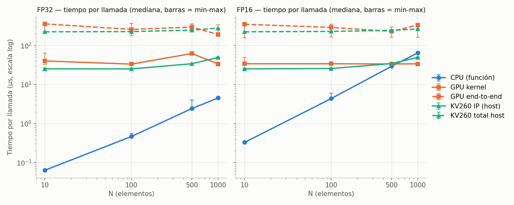
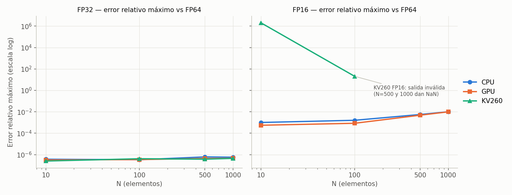
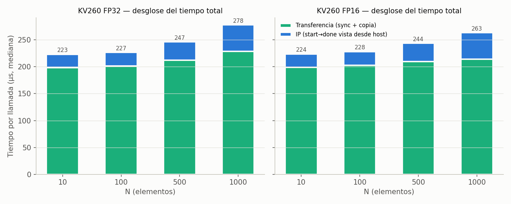
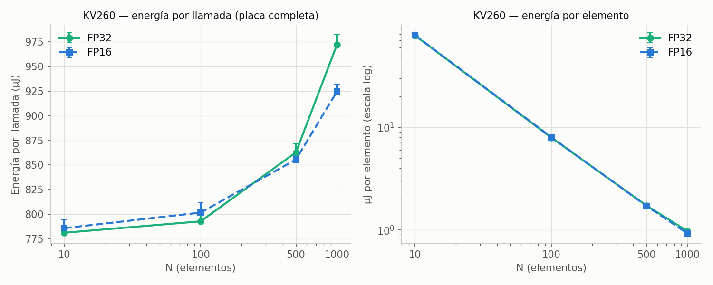

# Laboratorio Semana 13 — Softmax FP16/FP32 en CPU, GPU y FPGA

Softmax estable en FP16 y FP32, con entrada uniforme en [−4, 4], N ∈ {10, 100, 500, 1000} y referencia FP64 (`double`, `std::exp`).

```
m = max(x_i)        y_i = exp(x_i − m) / Σ exp(x_j − m)
```

| Carpeta | Contenido |
|---|---|
| [`CPU/`](CPU/) | Ej. A: `softmax_cpu.cpp`, `Resultados/` (CSV crudo, validaciones) |
| [`GPU/`](GPU/) | Ej. B: `softmax_cuda.cu`, `run_all.sh`, `results_gpu.csv`, `tegrastats.log` |
| [`FPGA/`](FPGA/) | Ej. C: kernel HLS (V0–V3), testbench, `run_hls.tcl`, host PYNQ, bitstreams, `Log_console.txt` |
| [`Analisis/`](Analisis/) | `generar_resultados.py`: tablas y figuras a partir de los datos crudos |

Todas las cifras salen de los datos crudos. En las tablas, "—" en potencia y energía significa que la plataforma no tiene sensor de potencia accesible.

---

## 1. Comandos

**CPU**
```bash
cd CPU
g++ -O3 -std=c++17 softmax_cpu.cpp -o softmax_cpu -lm
./softmax_cpu                                        # validación + barrido -> Resultados/mediciones_cpu.csv
./softmax_cpu --precision fp16 --n 100 --reps 10000
./softmax_cpu --precision fp32 --n 100 --reps 10000
```

**GPU (Jetson Nano)**: `bash run_all.sh`, que ejecuta:
```bash
nvcc -O3 -std=c++14 -arch=sm_53 softmax_cuda.cu -o softmax_cuda
sudo nvpmodel -q | tee power_mode.txt
tegrastats --interval 100 --logfile tegrastats.log &
./softmax_cuda --precision {fp16|fp32} --n {10|100|500|1000} --reps 10000 --measure {kernel|end-to-end}
nvprof --print-gpu-trace --log-file nvprof_fp16_kernel.txt ./softmax_cuda --precision fp16 --n 100 --reps 1000 --measure kernel
```

**FPGA**
```bash
vitis_hls -f run_hls.tcl && python extract_reports.py     # PC: {FP32,FP16} x {V0..V3}, csim/csynth/cosim, export IP
# Vivado: IP repo -> prj_<FP>_v3/sol1/impl/ip, Zynq MPSoC + softmax_hls, pl_clk0 = 100 MHz, bitstream
g++ -O2 gen_inputs.cpp -o gen_inputs && ./gen_inputs      # KV260
sudo env PATH=$PATH:/opt/xilinx/xrt/bin XILINX_XRT=/usr /usr/local/share/pynq-venv/bin/python3 \
     host_kv260.py --bit softmax_fp32.bit --precision fp32 --n 100 --reps 1000
cat /sys/class/hwmon/hwmon*/power1_input                  # potencia (µW) con carga sostenida
```

**Tablas y figuras**: `python Analisis/generar_resultados.py`

---

## 2. Implementación y protocolo

- **CPU:** en FP32 todo se calcula en `float`. En FP16 la entrada y la salida son `_Float16`, pero el máximo, `exp` y la suma se hacen en FP32, porque no hay `exp` en FP16.
- **GPU:** 1 bloque × 1024 hilos. Usa `__shared__ float s[1024]`, una reducción en árbol para el máximo y otra para la suma, y luego normaliza. En FP16 los datos son `__half` y el cálculo se hace en FP32.
  - `kernel`: kernels consecutivos medidos con `cudaEvent`.
  - `end-to-end`: H2D + kernel + sync + D2H.
- **FPGA:** `softmax_hls(const data_t x[1000], data_t y[1000], int n)` con `hls::exp`, `m_axi` para los datos y `s_axilite` para `n` y el control. Variantes:
  - V0: secuencial (`PIPELINE off`);
  - V1: `PIPELINE II=1`;
  - V2: `ARRAY_PARTITION cyclic 8` + 8 acumuladores parciales;
  - V3: `DATAFLOW`, que es la desplegada a 100 MHz.

  El host separa el tiempo en transferencia, IP y total.
- **Protocolo:** 1 llamada de calentamiento, 5 lotes por configuración (10 000 llamadas en CPU y GPU, 1 000 en KV260) y reporte de mediana [mín–máx].
- **Jetson Nano 2 GB** (`tegrastats` reporta 1980 MB de RAM): 2 núcleos activos a 921 MHz (consistente con el modo de 5 W), temperaturas de 28 a 32 °C.

---

## 3. Resultados

Tiempo por llamada en µs, como mediana [mín–máx]. El error es el error absoluto máximo contra FP64.

**FP32**

| Plataforma | N | Tiempo (µs) | Potencia (W) | Energía (µJ) | µJ/elem. | Error máx. |
|---|---:|---|---:|---:|---:|---:|
| CPU | 10 | 0,063 [0,062–0,064] | — | — | — | 3,2e-08 |
| CPU | 100 | 0,464 [0,462–0,551] | — | — | — | 7,2e-09 |
| CPU | 500 | 2,42 [2,24–3,96] | — | — | — | 4,6e-09 |
| CPU | 1000 | 4,50 [4,48–4,54] | — | — | — | 2,3e-09 |
| GPU kernel / e2e | 10 | 40,0 [33,1–63,5] / 356,8 [228–363] | — | — | — | 4,2e-08 |
| GPU kernel / e2e | 100 | 33,2 [33,0–33,3] / 257,2 [176–368] | — | — | — | 4,4e-09 |
| GPU kernel / e2e | 500 | 62,0 [61,9–62,3] / 295,7 [241–358] | — | — | — | 2,0e-09 |
| GPU kernel / e2e | 1000 | 33,7 [33,5–35,6] / 190,4 [187–339] | — | — | — | 1,1e-09 |
| KV260 (host) | 10 | 223,2 [223,0–225,2] | 3,50 | 781 | 78,1 | 1,8e-08 |
| KV260 (host) | 100 | 226,5 [226,3–229,4] | 3,50 | 793 | 7,93 | 1,1e-08 |
| KV260 (host) | 500 | 246,5 [246,4–249,1] | 3,50 | 863 | 1,73 | 1,3e-09 |
| KV260 (host) | 1000 | 277,8 [277,2–280,7] | 3,50 | 972 | 0,97 | 1,2e-09 |

**FP16**

| Plataforma | N | Tiempo (µs) | Potencia (W) | Energía (µJ) | µJ/elem. | Error máx. |
|---|---:|---|---:|---:|---:|---:|
| CPU | 10 | 0,328 [0,324–0,337] | — | — | — | 1,8e-04 |
| CPU | 100 | 4,35 [4,31–6,03] | — | — | — | 5,7e-05 |
| CPU | 500 | 29,3 [27,8–35,7] | — | — | — | 1,5e-05 |
| CPU | 1000 | 64,5 [62,5–67,3] | — | — | — | 9,0e-06 |
| GPU kernel / e2e | 10 | 33,9 [33,7–49,1] / 348,5 [155–364] | — | — | — | 5,2e-05 |
| GPU kernel / e2e | 100 | 33,9 [33,7–34,0] / 289,4 [163–348] | — | — | — | 2,4e-05 |
| GPU kernel / e2e | 500 | 33,5 [33,1–33,8] / 229,4 [163–297] | — | — | — | 6,9e-06 |
| GPU kernel / e2e | 1000 | 33,7 [33,0–35,4] / 330,9 [161–366] | — | — | — | 2,8e-06 |
| KV260 (host) | 10 | 223,9 [223,5–226,3] | 3,51 | 786 | 78,6 | inválido |
| KV260 (host) | 100 | 228,4 [228,2–231,4] | 3,51 | 802 | 8,02 | inválido |
| KV260 (host) | 500 | 243,8 [243,6–244,8] | 3,51 | 856 | 1,71 | NaN |
| KV260 (host) | 1000 | 263,4 [263,0–265,6] | 3,51 | 925 | 0,92 | NaN |

**Desglose de la KV260 en FP32** (mediana, µs). La transferencia es el 82–89 % del total:

| N | Transferencia | IP (vista desde host) | Total |
|---:|---:|---:|---:|
| 10 | 198,1 | 25,2 | 223,2 |
| 100 | 201,5 | 25,0 | 226,5 |
| 500 | 212,6 | 34,0 | 246,5 |
| 1000 | 228,6 | 49,2 | 277,8 |






### Energía (Ejercicio D)

| | KV260 | Jetson Nano 2 GB (GPU) | CPU (Codespaces) |
|---|---|---|---|
| Instrumento | Sensor de potencia de la placa, `/sys/class/hwmon/hwmon*/power1_input` (µW) | `tegrastats` (sin lectura de potencia) | Ninguno (máquina virtual) |
| Punto de medición | Entrada de la placa completa | No disponible | No disponible |
| ¿Incluye host? | Sí (ARM ejecutando Python) | — | — |
| Muestreo | Lecturas puntuales con carga sostenida (`--reps 1000000`), sin calentamiento | 10 Hz (1248 muestras ≈ 125 s) | — |
| Modo, frecuencia y temperatura | Bitstream fijo, PL a 100 MHz | 2 núcleos activos a 921 MHz (consistente con 5 W); CPU de 28 a 31,5 °C, GPU de 28,5 a 32 °C | 2 vCPU AMD EPYC 7763 |
| Potencia medida | Reposo 3,17 W / 3,10 W y activo 3,50 W / 3,51 W (FP32 / FP16) | No disponible | No disponible |

- **Cálculo en la KV260:** `E_llamada = P_activa × t_total` y `E_elemento = E_llamada / N`. Es la energía de la placa completa.
- **Energía dinámica** (P_activa − P_reposo) × t con N=1000: ≈ 92 µJ en FP32 y ≈ 108 µJ en FP16.
- **Jetson Nano, sin potencia:** se verificó que la Jetson Nano 2 GB usada no tiene los sensores de potencia que lee `tegrastats`. Por eso su registro solo muestra carga, frecuencias y temperaturas, sin los rieles `POM_5V_IN`, `POM_5V_GPU` ni `POM_5V_CPU`. Sin una lectura de potencia no se puede aplicar `E = (E_fin − E_inicio) / repeticiones`, así que la potencia y la energía de la GPU quedan sin valor. Medirlas requeriría un medidor externo en la alimentación de 5 V de la placa.
- **CPU:** se ejecutó en una máquina virtual de Codespaces, que no expone sensores de potencia.

---

## 4. Respuestas

**1. ¿Qué etapa domina?**
- **CPU:** el cómputo. Crece lineal con N (≈ 4,5 ns por elemento en FP32).
- **GPU:** costos fijos. El kernel tarda ~33 µs para todo N porque siempre usa 1024 hilos y reducciones de 10 niveles. En end-to-end, las copias y la sincronización cuestan entre 5 y 10 veces el kernel.
- **KV260:** la transferencia, entre 198 y 229 µs, que es el 82–89 % del total. El IP pasa de 25 a 49 µs con N.

**2. Error FP16 vs FP32.**
- En FP32 el error relativo es ~10⁻⁷ en las tres plataformas.
- En FP16 (CPU y GPU) va de 10⁻³ a 10⁻² y crece con N.
- Se debe al **formato**: la entrada y la salida se redondean a `half`, y con N grande muchos y_i caen en subnormales (< 6,1·10⁻⁵). No viene ni de `exp` ni de la reducción, porque ambas se calculan en FP32.
- La KV260 en FP16 da salida inválida (suma −50 053 en N=10, NaN en 500 y 1000). **No es desbordamiento:** cada exp(x_i − m) ≤ 1, así que la suma vale como mucho N ≤ 1000, muy lejos de 65 504. Además falla desde N=10. Apunta a un desajuste de formato entre host e IP: `softmax_fp16.hwh` es idéntico a `softmax_fp32.hwh` y la latencia del IP es igual en ambas precisiones.

**3. ¿Por qué la GPU es peor con vectores pequeños?** 
Por los costos fijos de lanzamiento, sincronización y `cudaMemcpy`. Con N=10, la CPU tarda 0,063 µs; el kernel GPU, ~33 µs; y el end-to-end, ~357 µs. Además, de 1024 hilos solo 10 tienen datos.

**4. Latencia HLS vs tiempo del host.**
- La latencia HLS es ciclos ÷ reloj y mide solo el IP.
- El `ip_us` del host (25–49 µs) suma el sondeo MMIO desde Python; por eso N=10 y N=100 dan lo mismo.
- El total (223–278 µs) agrega la copia y la sincronización de caché de XRT (~200 µs), que es costo de software y no de ancho de banda AXI.

**5. ¿Qué optimización HLS mejoró más la latencia?** 
No se puede responder con datos: los reportes de síntesis de V0–V3 (`csynth.rpt` / `hls_summary.csv`) no se conservaron en el repositorio.

**6. ¿Qué plataforma minimiza tiempo y energía?**
- **Tiempo:** gana la CPU en todos los casos, pero se midió en un x86 de Codespaces, no en la Jetson.
- **Energía por elemento:** solo la KV260 tiene sensor de potencia (de 78 µJ/elem con N=10 a ~0,95 µJ/elem con N=1000). Ni la Jetson Nano 2 GB ni la CPU virtual tienen uno, así que no se puede comparar entre plataformas.
- **FP16 vs FP32:** FP16 no aporta. En la CPU es entre 5 y 14 veces más lenta por las conversiones; en la GPU el tiempo es igual; y en la KV260 la salida es inválida.

---

## 5. Propuesta de optimización

- El costo fijo por invocación domina. En la KV260 la transferencia es el 82–89 % del total; en la GPU, el end-to-end cuesta entre 5 y 10 veces el kernel.
- Procesar B vectores por llamada reparte ese costo fijo: `t_vector ≈ T_fijo / B + t_cómputo`.
- **Propuesta:**
  - **KV260:** buffers de B×1000 elementos, una sola sincronización por lote y un argumento `batch` en el IP. Para N=1000 y B=64 el modelo predice ≈ 198/64 + 30 + 49 ≈ **82 µs por vector, frente a 278 µs** (unas 3,4 veces menos).
  - **GPU:** memoria *mapped* (la DRAM es compartida) para eliminar los `cudaMemcpy`, y `blockDim` ajustado a N con reducciones `__shfl_down_sync`.

---

## 6. Conclusiones

1. Con N ≤ 1000 dominan los costos fijos (transferencia, sincronización y lanzamiento), no el cálculo.
2. La CPU es la más rápida en los datos disponibles, con la salvedad de que se midió en x86.
3. FP32 es exacto (~10⁻⁷). FP16 pierde de 10⁻³ a 10⁻² por el formato, no por `exp` ni por la reducción.
4. Procesar por lotes es la optimización con más margen según la evidencia.

**Referencias:** AMD UG1399 (Vitis HLS); NVIDIA *CUDA C++ Programming Guide*; NVIDIA *Jetson Linux Developer Guide*.
